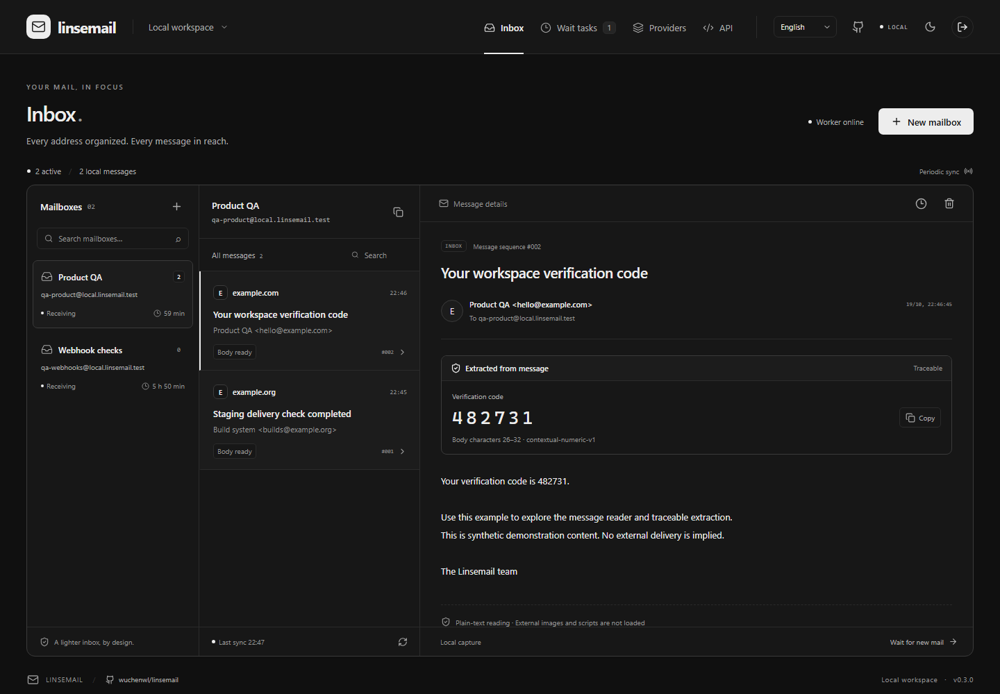
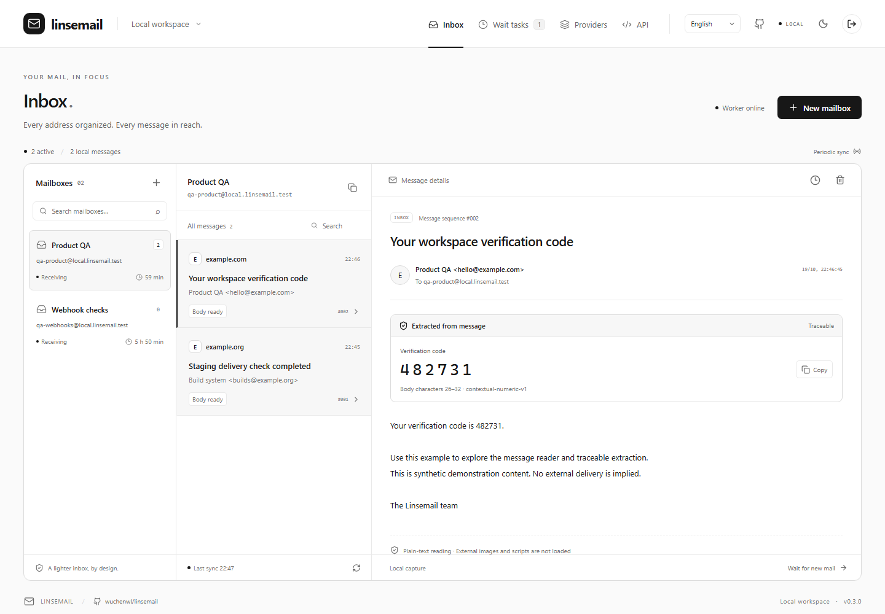
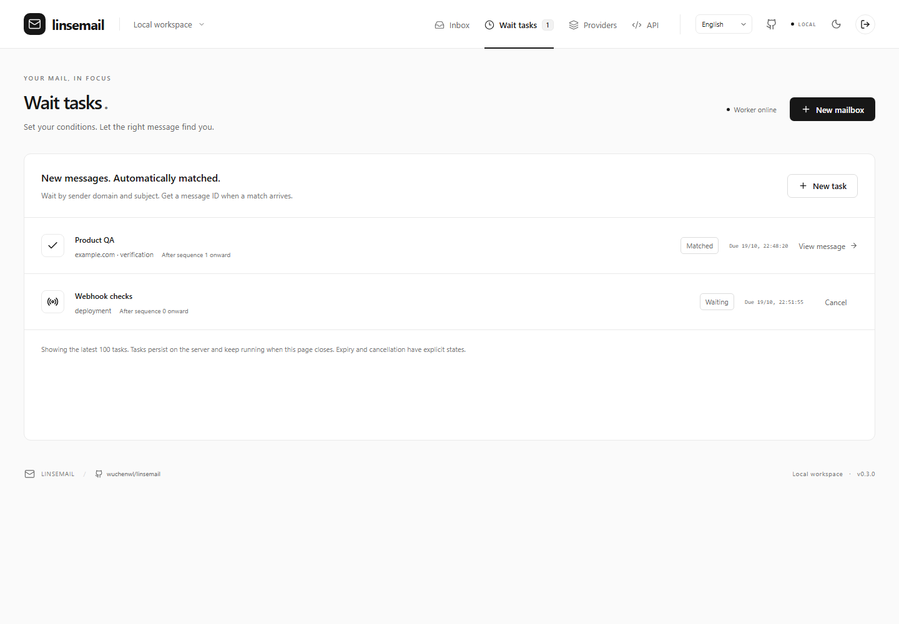
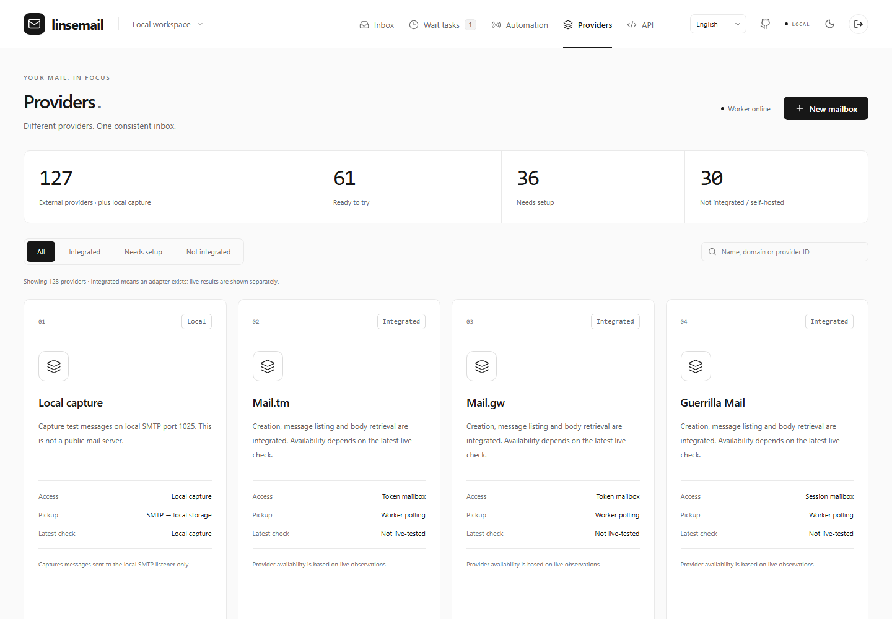
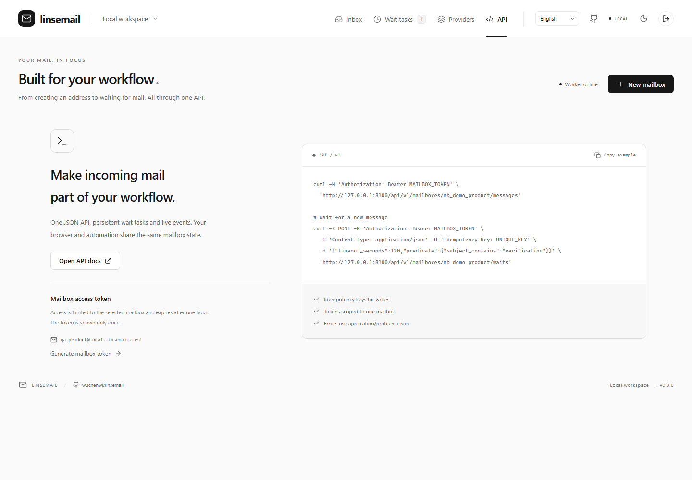
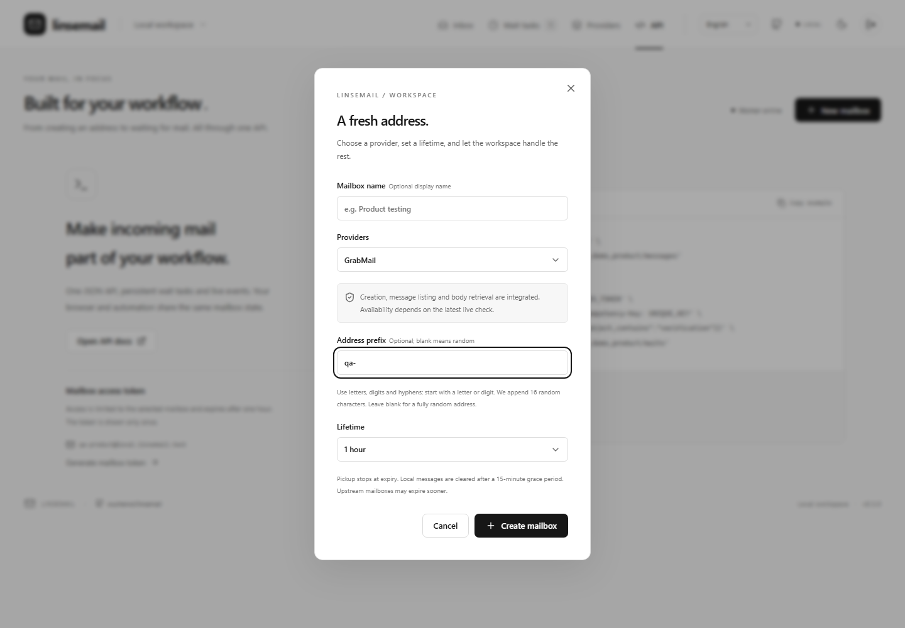
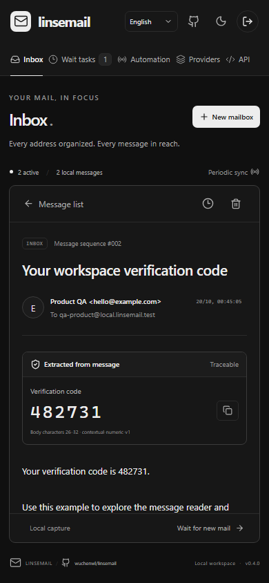
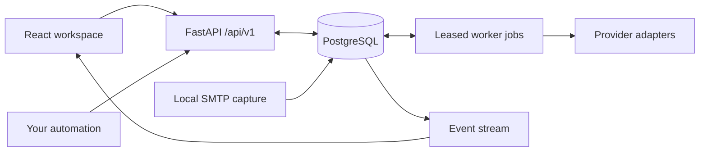

<div align="center">

# Linsemail

### One inbox. One API. Every message in focus.

A local-first temporary-mail workspace for developers, QA teams and automated workflows.

**English** · [简体中文](README.md) · [GitHub](https://github.com/wuchenwl/linsemail) · [Architecture](docs/architecture.md) · [API guide](docs/api.md)

[](https://github.com/wuchenwl/linsemail/stargazers)
[](https://github.com/wuchenwl/linsemail/releases)
[](https://github.com/wuchenwl/linsemail/blob/main/LICENSE)
[](https://github.com/wuchenwl/linsemail/releases/latest)
[](https://github.com/wuchenwl/linsemail/actions/workflows/ci.yml)

[](https://github.com/wuchenwl/linsemail/blob/main/README.en.md#quick-start)
[](https://github.com/wuchenwl/linsemail/blob/main/README.en.md#quick-start)
[](https://github.com/wuchenwl/linsemail/blob/main/docs/architecture.md#manual-setup)



</div>

Temporary-mail providers disagree on authentication, mailbox lifetime, message IDs, pagination and body formats. Linsemail turns those differences into a consistent workspace: create an address, receive messages, wait for a match and retrieve the result through the same API your interface uses.

The visual design is deliberately quiet. A monochrome palette, clear typography and a three-pane inbox keep addresses, message lists and message content together. Underneath, PostgreSQL, durable jobs and explicit operation states keep automation grounded in observable results.

## What makes it useful

- **A workspace, not just an address generator.** Manage mailbox lifetime, inspect sync freshness, read messages and track errors in one place.
- **One contract across provider protocols.** A shared API covers mailbox creation, message listing, body retrieval, scoped tokens, wait tasks and server-sent events.
- **Wait for the message you actually need.** Match new mail by sender domain, subject or text. Persisted tasks survive a closed browser tab and return an explicit message ID.
- **Extraction you can inspect.** Verification-code and link candidates retain source spans and rule IDs. Ambiguous matches remain visible instead of silently picking one.
- **Original mailbox identity throughout.** Reconnect to the saved session, preserve the address and fetch only message IDs observed in that inbox.
- **Credentials stay behind the API.** Provider configurations and mailbox sessions are encrypted locally. Mailbox-scoped tokens let scripts access one inbox rather than the whole workspace.
- **Local SMTP capture included.** Exercise your own application’s mail flow without depending on an external temporary-mail provider.

## Provider coverage, precisely stated

| Catalog at v0.3.0 | Count | Meaning |
| --- | ---: | --- |
| External provider entries | 127 | Discovered services with catalog metadata |
| Implemented external adapters | 97 | Executable create/list/body protocols |
| Adapters without a platform key | 61 | Can attempt the anonymous flow; availability varies |
| Adapters requiring platform credentials | 34 | Supply your own provider account key |
| Adapters requiring a self-hosted deployment | 2 | Configure your own receiving endpoint and domain |
| Remaining catalog entries | 30 | Not integrated, forwarding-only or deployment-dependent |
| Built-in local capture | 1 | Separate from external-provider totals |

**An implemented adapter is not a delivery guarantee.** Entries can share infrastructure, require a paid plan or become unavailable. The interface reports admission and recent checks separately. Website signup compatibility is not an advertised capability.

Custom prefixes are supported by **GrabMail, TempMail.plus, BYOM, Maildrop and InboxKitten**. A supplied prefix receives a 16-character random suffix; leaving it blank generates a random local part. Other providers reject non-empty custom prefixes explicitly.

## A closer look

Screenshots show the actual interface with reproducible **synthetic demo data**, not private inboxes or proof of provider delivery.

| Welcome | Message workspace |
| --- | --- |
|  |  |

| Persistent wait tasks | Provider catalog |
| --- | --- |
|  |  |

| API workspace | Mailbox creation |
| --- | --- |
|  |  |

<details>
<summary>Mobile reading experience</summary>



</details>

## Quick start

The automated launcher currently targets **Windows**. Install **Python 3.11+** and **Node.js 22.12+**, extract or clone the source and open PowerShell in the project directory:

```powershell
.\scripts\start-console.ps1
```

The launcher creates a virtual environment, installs locked dependencies, builds the interface and starts a local PostgreSQL database, API and worker. Dependency installation requires network access. It does not create external-provider accounts.

Open **<http://127.0.0.1:8100>**. API explorer: **<http://127.0.0.1:8100/api/docs>**. Use **Language / 语言** on the welcome screen or workspace header to switch languages.

```powershell
# Subsequent runs after dependencies and frontend are ready
.\scripts\start-console.ps1 -SkipInstall -SkipBuild

# Stop managed processes; preserve local data
.\scripts\stop-console.ps1
```

The console, database credentials and encryption key are kept in `.runtime/`, which is excluded from Git and release archives. The local SMTP listener uses `127.0.0.1:1025`; it is a test capture endpoint, not a public mail server.

For Linux/macOS or an existing PostgreSQL instance, see [manual setup](docs/architecture.md#manual-setup). The bundled Windows process launcher is not used in that path. `.env.example` documents process environment variables; the application does not automatically load `.env` files.

## Automate an inbox

Read your workspace token from `.runtime/admin.local.json` locally. Substitute it for `WORKSPACE_TOKEN` below; keep the real value out of screenshots, issues and commits.

```bash
curl -X POST 'http://127.0.0.1:8100/api/v1/mailboxes' \
  -H 'Authorization: Bearer WORKSPACE_TOKEN' \
  -H 'Content-Type: application/json' \
  -H 'Idempotency-Key: mailbox-example-001' \
  -d '{"provider_id":"grabmail","address_prefix":"qa-","ttl_seconds":3600}'
```

Creation returns **202 Accepted** with an operation ID and mailbox resource ID. Poll the operation before treating the mailbox as ready. Then create a persistent wait:

```bash
curl -X POST 'http://127.0.0.1:8100/api/v1/mailboxes/MAILBOX_ID/waits' \
  -H 'Authorization: Bearer WORKSPACE_TOKEN' \
  -H 'Content-Type: application/json' \
  -H 'Idempotency-Key: wait-example-001' \
  -d '{"timeout_seconds":120,"predicate":{"subject_contains":"verification"}}'
```

Poll the returned wait ID or consume events. A match gives you a message ID that can be read from that mailbox. The [API guide](docs/api.md) explains tokens, cursors, wait states and errors. Runtime OpenAPI at `/api/v1/openapi.json` is authoritative for the console; root `openapi.json` describes the separate legacy API.

## Architecture at a glance



The [architecture guide](docs/architecture.md) describes transaction boundaries, worker leases, ingestion sequence numbers, retention and the local trust boundary.

## Develop and verify

With PostgreSQL configured and dependencies installed:

```bash
python -m pytest backend/tests tests -q
node scripts/test-i18n.cjs
npm run build --prefix frontend
```

Integration tests use disposable database schemas. Run them against a dedicated development database. Protocol tests use controlled upstream responses; they do not imply that every provider is currently reachable.

```bash
# Produce clean source archives and verify their contents
python scripts/package-release.py
python scripts/check-release.py
```

Archives include source, lockfiles, tests, documentation and screenshots. Runtime data, research captures, credentials, dependencies and compiled bundles are excluded. See [Contributing](CONTRIBUTING.md), [Security](SECURITY.md), [Changelog](CHANGELOG.md) and [Third-party notices](THIRD_PARTY_NOTICES.md).

## Community acknowledgements

Thank you to the [LINUX DO](https://linux.do/) community for providing an open platform for technical discussion and sharing open-source projects.

## License

Project code is released under the [MIT license](LICENSE). Upstream providers and dependencies retain their own terms and licenses.
