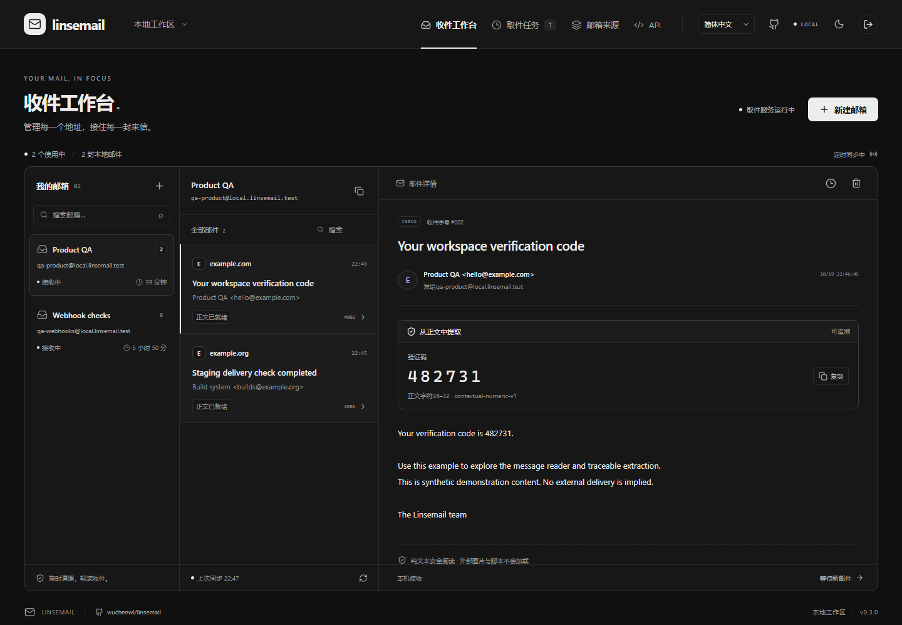
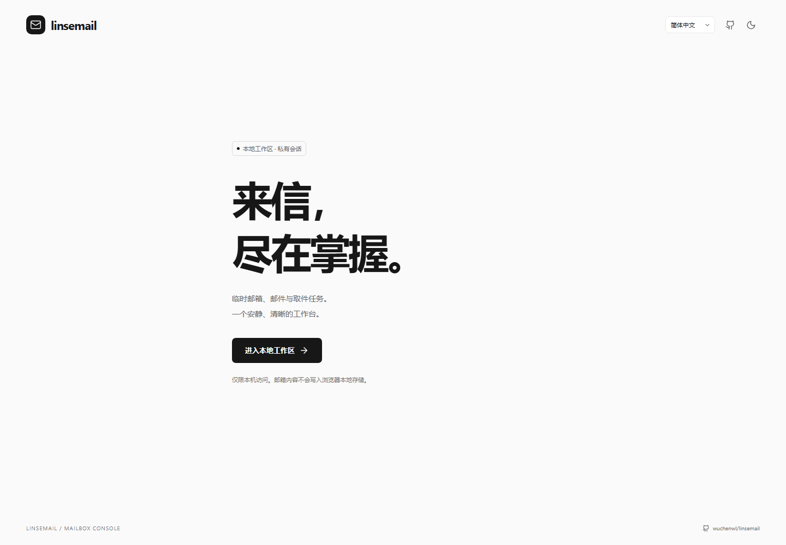
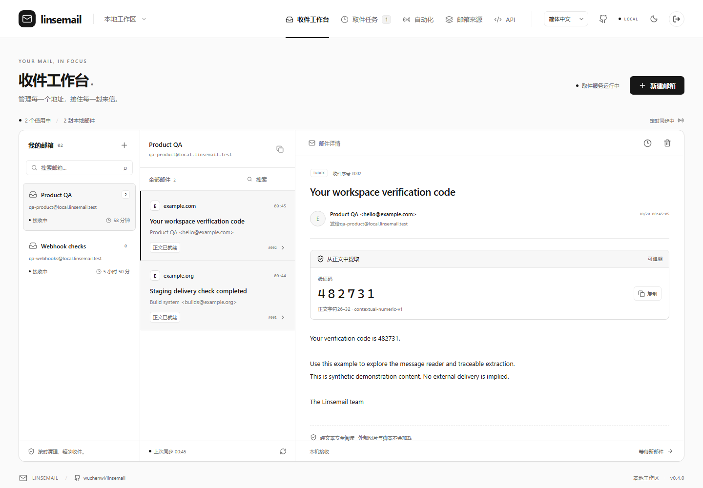
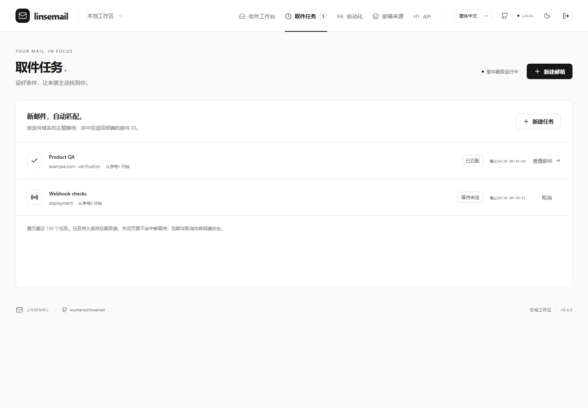
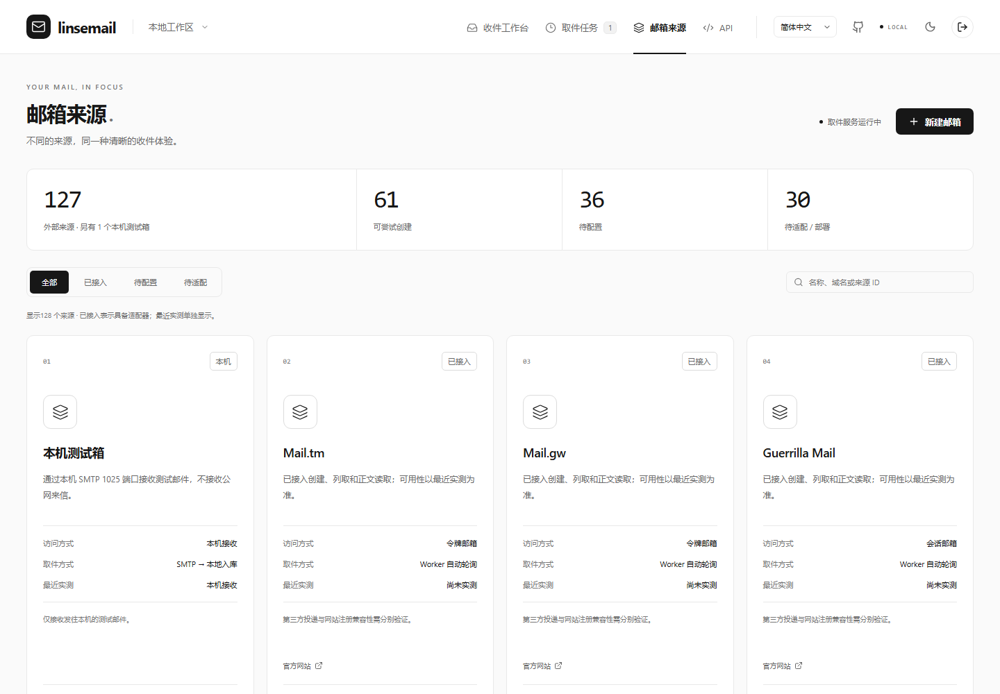
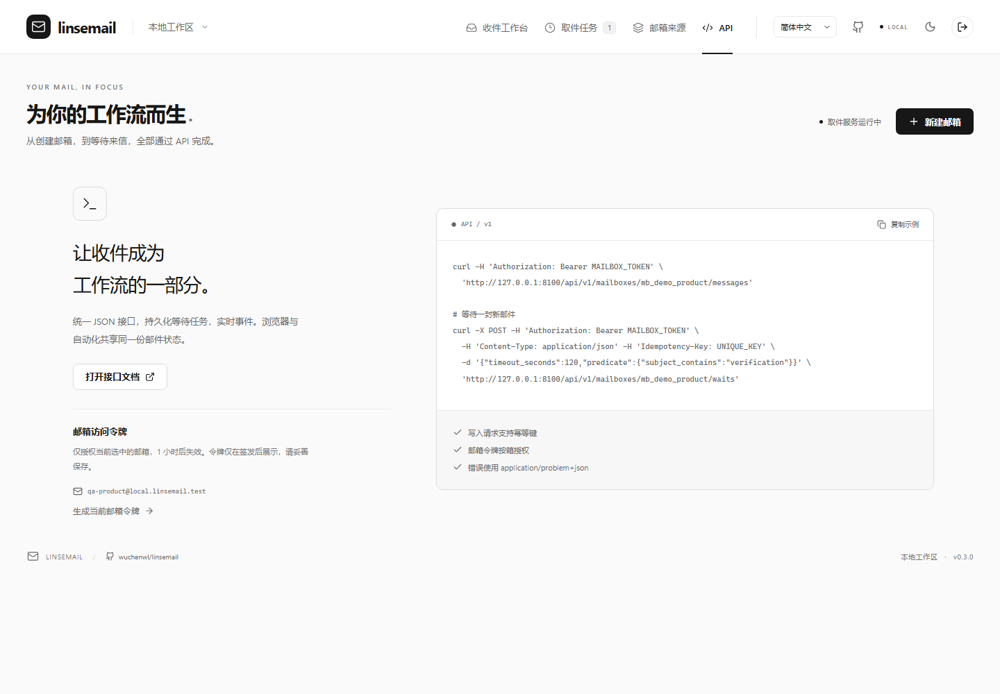
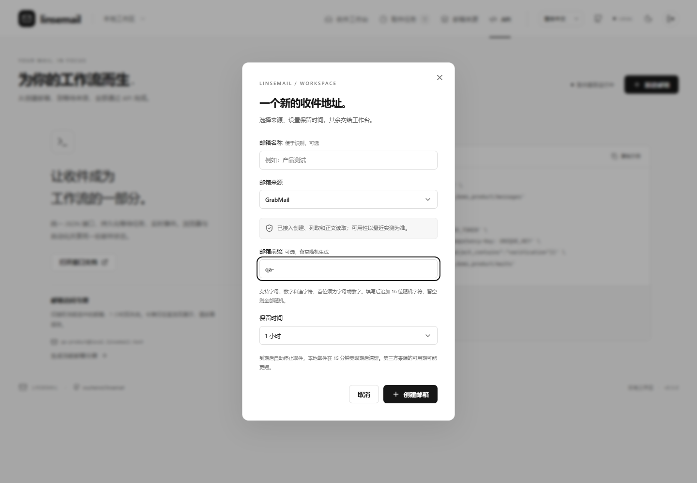
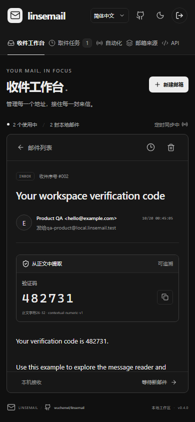
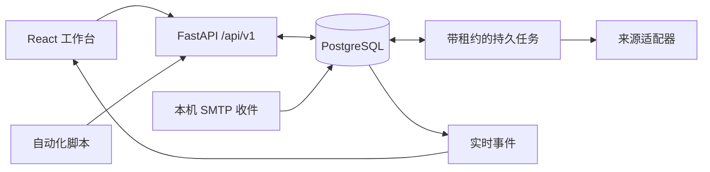

<div align="center">

# Linsemail

### 一个收件台，一套 API，让每封来信清晰可见。

面向开发者、QA 与自动化工作流的本地优先临时邮箱工作台。

[English](README.en.md) · **简体中文** · [GitHub 仓库](https://github.com/wuchenwl/linsemail) · [架构设计](docs/architecture.zh-CN.md) · [API 指南](docs/api.zh-CN.md)

[](https://github.com/wuchenwl/linsemail/stargazers)
[](https://github.com/wuchenwl/linsemail/releases)
[](https://github.com/wuchenwl/linsemail/blob/main/LICENSE)
[](https://github.com/wuchenwl/linsemail/releases/latest)
[](https://github.com/wuchenwl/linsemail/actions/workflows/ci.yml)

[](https://github.com/wuchenwl/linsemail#快速开始)
[](https://github.com/wuchenwl/linsemail#快速开始)
[](https://github.com/wuchenwl/linsemail/blob/main/docs/architecture.zh-CN.md#手动部署)



</div>

临时邮箱的难点，从来不止于生成一个地址。不同来源使用不同的鉴权方式、有效期、分页规则和正文格式；真正的工作流还要知道：地址是否就绪、邮件是否入库、等待是否命中、错误能否追踪。

Linsemail 把这些差异收敛到一套可观察的收件流程：**创建地址 → 持续取件 → 匹配来信 → 读取结果**。浏览器与脚本使用同一套 API，共享同一份邮箱状态。PostgreSQL、持久化任务和明确的状态转换负责承接实际工作；三栏收件台用于查看地址、邮件列表与正文。

## 为完整的收件流程而设计

- **管理邮箱，而不只是生成地址。** 在一个工作台里管理有效期、同步新鲜度、邮件正文和来源错误。
- **把不同协议接成同一种调用方式。** 创建、列信、获取正文、签发受限令牌、等待任务与实时事件共用统一 JSON 接口。
- **等待需要的那封邮件。** 按发件域名、主题或正文匹配新来信；任务持久保存在服务端，关闭浏览器也不会中断等待，命中后返回明确的邮件 ID。
- **提取结果可核对。** 验证码与链接候选保留正文字符位置、规则 ID 与歧义状态；信息不充分时，不替使用者悄悄做决定。
- **始终读取原来的邮箱。** 保存并重连原会话，校验地址身份，仅允许读取本箱列表中已经出现过的消息 ID。
- **凭证留在本地服务端。** 来源配置与邮箱会话加密保存；按箱授权的访问令牌适合接入脚本，避免把整个工作区权限交给单个任务。
- **自带本机 SMTP 测试箱。** 无需依赖外部临时邮箱，即可验证自己应用的邮件发送与收件流程。

## 覆盖范围，清楚地说

| v0.3.1 目录状态 | 数量 | 含义 |
| --- | ---: | --- |
| 外部来源 | 127 | 已收录的服务与公开接口元数据 |
| 已实现外部适配器 | 97 | 已接通创建、列信与正文读取协议 |
| 无需平台密钥的适配器 | 61 | 可尝试匿名流程，可用性随上游变化 |
| 需要平台凭证的适配器 | 34 | 需配置自己的来源账户密钥 |
| 需要自部署配置的适配器 | 2 | 需自己的部署地址与收件域名 |
| 其余目录来源 | 30 | 尚未接通、仅转发或仍有部署条件 |
| 内置本机测试箱 | 1 | 单独统计，不计入外部来源数量 |

**97 是适配器实现数，不是 97 家当前投递成功的承诺。** 部分来源共用后台，部分需要付费账户，接口也可能变化。工作台将接入条件与最近实测分开展示，不把网站注册兼容性当作产品承诺。

**GrabMail、TempMail.plus、BYOM、Maildrop、InboxKitten** 支持自定义邮箱前缀：填写后追加 16 位随机字符，留空生成随机用户名。其他来源收到非空前缀时会明确报错，不会静默忽略。

## 界面一览

以下截图来自真实界面渲染，使用可复现的**合成演示数据**，不包含私人邮箱、真实密钥，也不作为第三方投递证明。

| 进入工作区 | 浅色收件台 |
| --- | --- |
|  |  |

| 持久化取件任务 | 来源与接入状态 |
| --- | --- |
|  |  |

| API 工作流 | 创建与自定义前缀 |
| --- | --- |
|  |  |

<details>
<summary>移动端阅读体验</summary>



</details>

## 快速开始

一键启动脚本当前面向 **Windows**。安装 **Python 3.11+** 与 **Node.js 22.12+**，解压或克隆源码后，在项目根目录打开 PowerShell：

```powershell
.\scripts\start-console.ps1
```

脚本会创建虚拟环境、安装锁定依赖、构建前端，并启动本地 PostgreSQL、API 与取件 worker。首次安装依赖需要网络；脚本不会替你注册外部来源账户。

工作台：**<http://127.0.0.1:8100>**。交互式接口文档：**<http://127.0.0.1:8100/api/docs>**。在入口或顶栏通过 **Language / 语言** 切换中英文。

```powershell
# 依赖安装、前端构建完成后的再次启动
.\scripts\start-console.ps1 -SkipInstall -SkipBuild

# 停止托管进程，保留本地数据
.\scripts\stop-console.ps1
```

运行数据、数据库凭证和加密密钥保存在 `.runtime/`，不会进入 Git 或发布包。本机 SMTP 使用 `127.0.0.1:1025`，用于测试收件，不是公网邮件服务器。

Linux/macOS 或已有 PostgreSQL 实例请参考[手动部署](docs/architecture.zh-CN.md#手动部署)，不使用 Windows 进程管理脚本。`.env.example` 是进程环境变量参考，程序不会自动加载 `.env`。

## 接入你的自动化

在本机读取 `.runtime/admin.local.json` 中的工作区令牌，替换下方 `WORKSPACE_TOKEN`。真实令牌不应写入 issue、截图或提交记录。

```bash
curl -X POST 'http://127.0.0.1:8100/api/v1/mailboxes' \
  -H 'Authorization: Bearer WORKSPACE_TOKEN' \
  -H 'Content-Type: application/json' \
  -H 'Idempotency-Key: mailbox-example-001' \
  -d '{"provider_id":"grabmail","address_prefix":"qa-","ttl_seconds":3600}'
```

创建返回 **202 Accepted**，包含操作 ID 与邮箱资源 ID。轮询操作完成后再将邮箱视为可用，然后创建一个持久化等待任务：

```bash
curl -X POST 'http://127.0.0.1:8100/api/v1/mailboxes/MAILBOX_ID/waits' \
  -H 'Authorization: Bearer WORKSPACE_TOKEN' \
  -H 'Content-Type: application/json' \
  -H 'Idempotency-Key: wait-example-001' \
  -d '{"timeout_seconds":120,"predicate":{"subject_contains":"verification"}}'
```

轮询返回的等待任务 ID，或消费实时事件。命中结果包含明确的消息 ID，再从原邮箱读取正文。[API 指南](docs/api.zh-CN.md)说明令牌权限、游标、等待状态与错误语义。控制台以运行时 `/api/v1/openapi.json` 为准；根目录 `openapi.json` 属于独立的旧版 API。

## 架构概览



详细的事务边界、worker 租约、收件序号、保留策略与本机信任边界见[架构设计](docs/architecture.zh-CN.md)。

## 开发与验证

配置好 PostgreSQL、安装依赖后执行：

```bash
python -m pytest backend/tests tests -q
node scripts/test-i18n.cjs
npm run build --prefix frontend
```

后端集成测试使用隔离数据库 schema，请连接专用开发数据库。来源协议测试使用受控响应，不意味着所有服务当前在线。

```bash
# 生成干净源码包，并验证包内内容
python scripts/package-release.py
python scripts/check-release.py
```

发布包包含源码、锁文件、测试、文档与截图；排除运行数据、研究快照、凭证、依赖目录及编译产物。参与贡献见 [CONTRIBUTING](CONTRIBUTING.md)，安全说明见 [SECURITY](SECURITY.md)，版本变化见 [CHANGELOG](CHANGELOG.md)，依赖说明见 [THIRD_PARTY_NOTICES](THIRD_PARTY_NOTICES.md)。

## 社区致谢

感谢 [LINUX DO](https://linux.do/) 社区提供开放的技术交流与开源分享平台。

## 开源许可

项目代码采用 [MIT License](LICENSE)。外部服务条款、依赖许可证与各自的署名要求独立适用。
