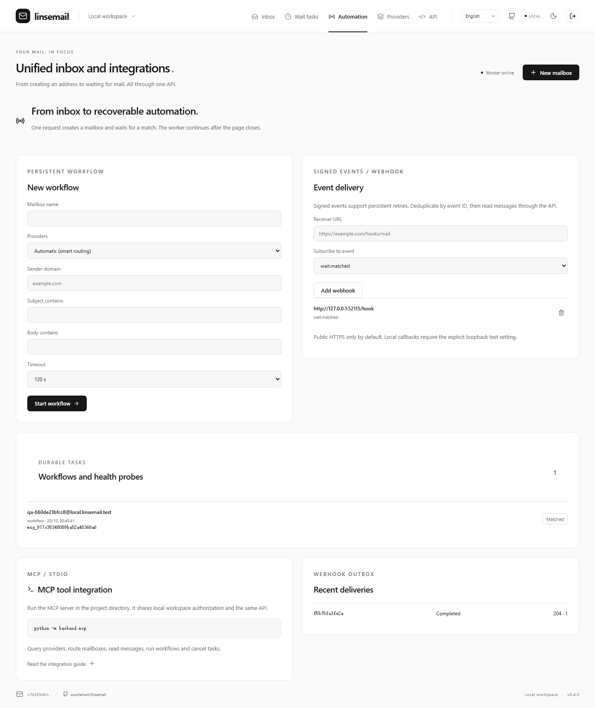
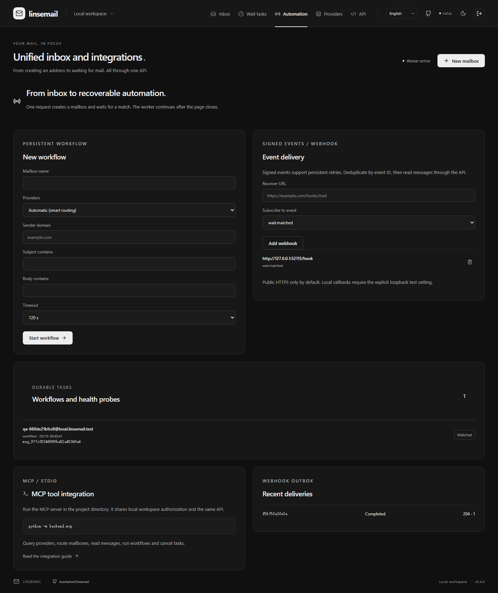

# Developer tools and event integrations

[简体中文](agent.zh-CN.md) · [API](api.md) · [Architecture](architecture.md)

MCP, the browser, webhooks and scripts share `/api/v1`, mailbox identities and authorization. MCP accesses mailbox resources through the unified API, using the same authorization and task states as the workspace.

## MCP over stdio

Start the API and worker, then run `python -m backend.mcp` from the project directory. The newline-delimited JSON-RPC stdio server supports MCP `2025-06-18` and `2024-11-05`. Its 11 tools cover providers, measured health, routing, mailbox creation, operation lookup, message reading, composite workflows and cancellation. HTTP MCP and OAuth are not implemented.

Configure an MCP client with the following example, replacing `PROJECT` with an absolute path. On Windows use `PROJECT/.venv/Scripts/python.exe`. The explicit working directory makes module imports independent of the client launcher.

```json
{
  "mcpServers": {
    "linsemail": {
      "command": "PROJECT/.venv/bin/python",
      "args": ["-c", "import os,runpy; os.chdir('PROJECT'); runpy.run_module('backend.mcp', run_name='__main__')"],
      "env": {"LINSEMAIL_RUNTIME": "PROJECT/.runtime", "LINSEMAIL_API_URL": "http://127.0.0.1:8100/api/v1"}
    }
  }
}
```

The server reads the workspace token from `admin.local.json` in the runtime directory, or from the process environment variable `LINSEMAIL_API_TOKEN`. Do not commit real tokens. Mailbox tokens retain their existing scope restrictions and cannot create workspace workflows.

Omit `provider_id` in `create_mailbox` or `create_workflow` for smart routing. Select `local` explicitly for SMTP capture. Reuse an `idempotency_key` when retrying writes; changing the body with the same key produces a conflict.

## Durable workflows

`POST /api/v1/workflows` accepts mailbox options, a `predicate` (`from_domain`, `subject_contains`, `text_contains`) and a total `timeout_seconds` of 5–300. It returns 202 and a task ID. Poll `/api/v1/tasks/TASK_ID`; a match provides `result.mailbox_id` and `result.matched_message_id`. Read the message detail for text and extraction candidates. The result also retains operation and wait IDs.

Persisted leases and stable step idempotency keys recover after worker restarts. An uncertain upstream create fails the workflow and preserves the original operation; it never silently creates another mailbox. Cancellation retains any mailbox already created, and an external request already in flight may still complete. The timeout covers the entire composite workflow.

## Signed webhooks

Create a subscription with `POST /api/v1/webhooks`, a workspace Bearer token, an `Idempotency-Key`, and a body such as `{"url":"https://example.com/hooks/mail","events":["wait.matched","message.received"]}`. Save the returned `secret`; listing subscriptions does not reveal it. Replaying the same idempotent creation returns the same secret. The secret is encrypted at rest; idempotency records contain metadata only. DELETE disables the subscription and stops subsequent retries.

Events and outbox rows commit atomically. Payloads contain event/resource IDs, sequence and version, never email text, extracted values or upstream credentials. Fetch authorized details through the API.

Headers include `X-Linsemail-Event-ID`, `X-Linsemail-Delivery-ID` and `X-Linsemail-Signature: t=TIMESTAMP,v1=HEX`. Compute HMAC-SHA256 over `timestamp + b'.' + raw_body` with the signing secret. Compare in constant time, reject timestamps outside a 300-second tolerance, deduplicate by event ID and return 2xx promptly.

Delivery is at least once, with up to 6 execution attempts and capped exponential backoff. Retries retain event IDs and generate fresh timestamps/signatures. A timeout may occur after the receiver handled a request, so receiver deduplication is required. `/api/v1/webhook-deliveries` shows the last 100 deliveries. Terminal tasks/deliveries and observations are retained for 7 days; statistics use a 24-hour window.

Public HTTPS is required by default. Private/link-local addresses, URL credentials and redirects are rejected. DNS is checked again before sending; each connection pins a validated IP and verifies the TLS hostname. For local testing, explicitly set `LINSEMAIL_WEBHOOK_ALLOW_LOOPBACK=1` for both API and worker. This permits loopback callbacks only, not arbitrary private networks.

## Probes and measurement

The worker queues one enabled external provider every 300 seconds, rotating through sources. A probe creates and lists a mailbox, then deletes its local probe mailbox. Existing per-provider budgets and four shared worker slots apply. Set `LINSEMAIL_PROVIDER_PROBES=0` to disable probes or configure `LINSEMAIL_PROVIDER_PROBE_INTERVAL` (minimum 60 seconds). Manual probes use `POST /providers/PROVIDER/probes` and the same task API.

Probes do not send email: their result says `delivery_tested=false`. Delivery success uses completed waits: matched is success, timeout/expiry is failure, cancellation is excluded. This measures observed matching outcomes, including sender and predicate effects; it is not an independent provider delivery SLA. No samples means unknown, never 100%.


Local end-to-end UI capture with synthetic SMTP mail and a loopback receiver. No external delivery is implied.




