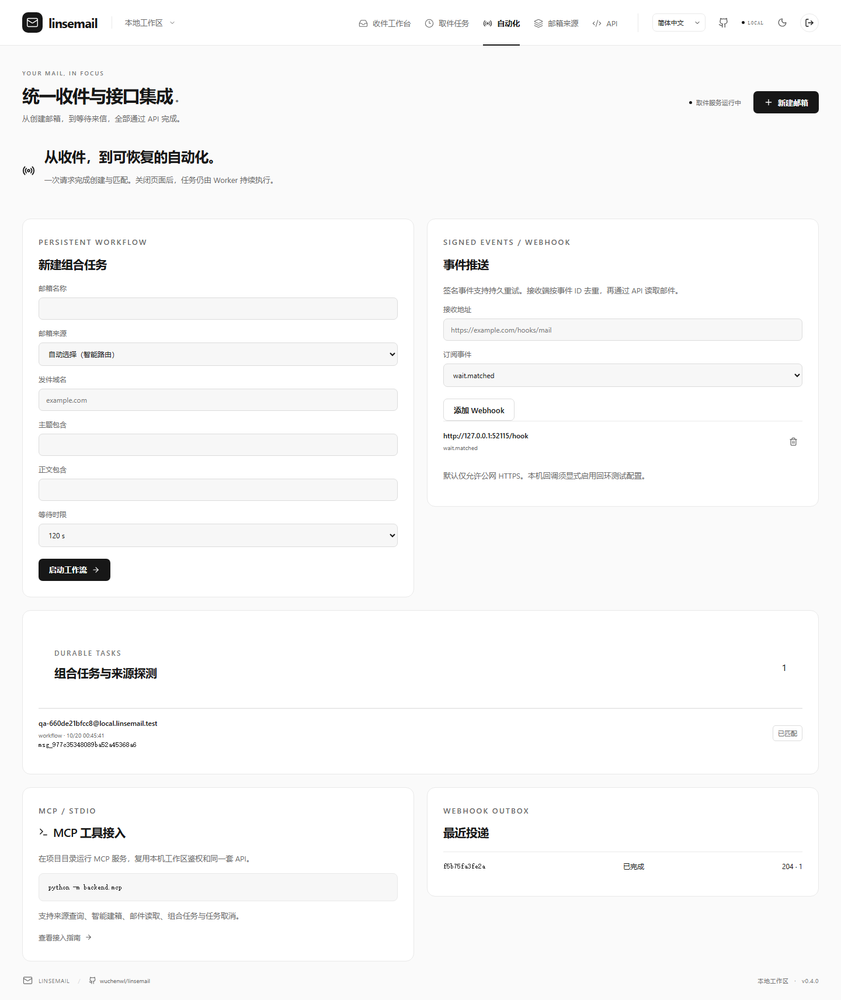
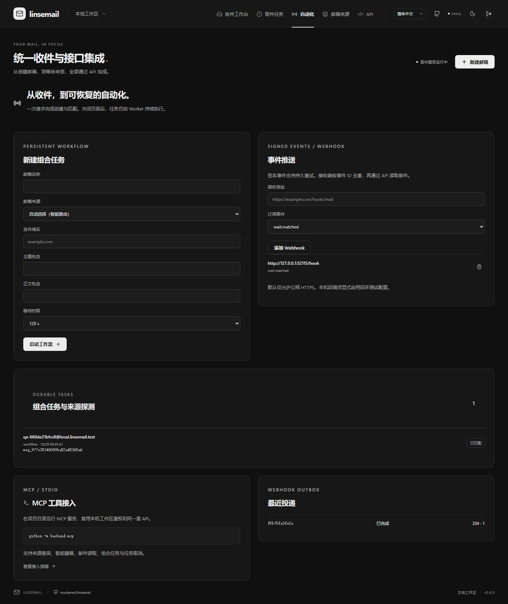

# 开发工具与事件接入

[English](agent.md) · [API](api.zh-CN.md) · [架构](architecture.zh-CN.md)

Linsemail 的 MCP、浏览器、Webhook 与脚本共享 `/api/v1`，使用相同的邮箱、任务与权限模型。MCP 通过统一 API 访问邮箱资源，沿用工作区的鉴权与任务状态。

## MCP：stdio

先启动 API 和 worker，再从项目目录运行 `python -m backend.mcp`。支持 MCP `2025-06-18` 与 `2024-11-05` 的 JSON-RPC stdio 工具协议；一行一个 JSON，不向 stdout 输出日志。目前提供 11 个工具，覆盖来源与指标查询、路由预览、建箱、操作查询、邮件读取、组合任务与取消。未实现 MCP HTTP 传输或 OAuth。

在支持 MCP 的客户端中配置以下内容，将 `PROJECT` 替换为项目绝对路径。Python 模块必须能从该目录导入，因此这里用 `-c` 明确设置工作目录。Windows Python 路径可改为 `PROJECT/.venv/Scripts/python.exe`。

```json
{
  "mcpServers": {
    "linsemail": {
      "command": "PROJECT/.venv/bin/python",
      "args": ["-c", "import os,runpy; os.chdir('PROJECT'); runpy.run_module('backend.mcp', run_name='__main__')"],
      "env": {"LINSEMAIL_RUNTIME": "PROJECT/.runtime", "LINSEMAIL_API_URL": "http://127.0.0.1:8100/api/v1"}
    }
  }
}
```

默认从工作区运行目录的 `admin.local.json` 读取工作区密钥；也可通过进程环境 `LINSEMAIL_API_TOKEN` 提供已有令牌。不要把实际令牌写入公共配置或 issue。邮箱令牌仍受原有按箱限制，不能创建工作区级组合任务。

调用 `create_mailbox` 或 `create_workflow` 时省略 `provider_id` 可启用智能路由。需要真实本机测试箱时显式传 `local`。重试写入时重复使用同一个 `idempotency_key`；相同键搭配不同请求会返回冲突，而不是新建邮箱。

## Persistent Workflow

```http
POST /api/v1/workflows
Authorization: Bearer TOKEN
Idempotency-Key: workflow-example-001
Content-Type: application/json

{"predicate":{"from_domain":"example.com","subject_contains":"verification"},"timeout_seconds":120}
```

返回 202 和持久任务 ID。轮询 `GET /api/v1/tasks/TASK_ID`；命中后读取 `result.mailbox_id` 与 `result.matched_message_id`，通过邮件详情接口取正文与提取候选。结果页同时保留操作和等待 ID，便于排错。

任务的创建、建箱和等待分别有幂等键与租约。worker 重启后继续查询原操作，避免重新建箱。上游创建结果不确定时进入失败状态，保留原操作供人工核对，绝不自动换来源生成第二个地址。取消任务保留已经创建的邮箱；外部操作已经开始时仍可能完成。超时覆盖整个组合流程，最长 300 秒。

## Webhook：签名、去重与重试

```http
POST /api/v1/webhooks
Authorization: Bearer TOKEN
Idempotency-Key: webhook-example-001
Content-Type: application/json

{"url":"https://example.com/hooks/mail","events":["wait.matched","message.received"]}
```

创建响应包含签名 `secret`，请立即保存。相同幂等键重放可取回同一密钥；列表接口不返回密钥。密钥在数据库中通过 Fernet 加密，幂等记录只保存订阅元数据。删除接口停用订阅并停止其后续重试。

事件与 outbox 记录在同一数据库事务中提交。通知只含事件 ID、序号、资源 ID 和版本，不携带邮件正文、提取值或上游会话。接收端使用工作区 API 读取有权限的详情。

每次 POST 带 `X-Linsemail-Event-ID`、`X-Linsemail-Delivery-ID` 与 `X-Linsemail-Signature: t=TIMESTAMP,v1=HEX`。签名原文为时间戳、一个英文句点、原始请求体字节；摘要为 HMAC-SHA256。接收端应检查时间偏差不超过 300 秒，并按事件 ID 去重，再尽快返回 2xx。

```python
import hashlib, hmac, time

def valid_signature(secret, header, raw_body):
    try:
        values = dict(part.split('=', 1) for part in header.split(','))
        timestamp = values['t']
        if abs(time.time() - int(timestamp)) > 300:
            return False
        expected = hmac.new(secret.encode(), timestamp.encode() + b'.' + raw_body, hashlib.sha256).hexdigest()
        return hmac.compare_digest(expected, values['v1'])
    except (KeyError, ValueError):
        return False
```

投递是至少一次语义，最多 6 次执行尝试，失败采用有上限的指数退避；重试沿用同一事件 ID，时间戳和签名重新生成。超时不代表接收端没有处理，因此接收端必须去重。`GET /api/v1/webhook-deliveries` 显示最近 100 条结果。任务与投递终态、来源观测保留 7 天，指标窗口为最近 24 小时。

默认只允许公网 HTTPS，拒绝内网、链路本地地址、URL 用户信息与重定向。发送前重新解析 DNS，校验所有地址，并固定本次连接 IP，同时保留 TLS 主机名校验。测试本机接收端时显式设置 `LINSEMAIL_WEBHOOK_ALLOW_LOOPBACK=1` 并重启 API 与 worker；该选项只增加回环地址，不放行其他内网地址。

## 来源探测与统计解释

worker 默认每 300 秒排队一个已启用外部来源，轮换执行建箱和列信，完成后删除本地探测箱。每次网络调用仍受来源预算和 4 个并发槽限制。`LINSEMAIL_PROVIDER_PROBES=0` 关闭主动探测；`LINSEMAIL_PROVIDER_PROBE_INTERVAL` 调整全局间隔，最小 60 秒。手动探测使用 `POST /providers/PROVIDER/probes`，结果使用同一任务接口读取。

探测不会自动发送邮件，因此 `delivery_tested=false`。收件成功率只来自已结束等待任务：命中算成功，超时或到期算失败，人工取消不计入。它是使用中观测到的匹配率，会受到发送方和匹配条件影响，不等于邮箱平台的独立投递 SLA。没有样本时显示未知，不显示 100%。


本机端到端界面截图，使用合成 SMTP 邮件与回环接收端，不代表第三方投递证明。




